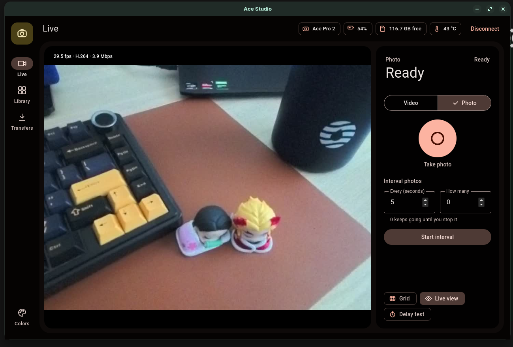
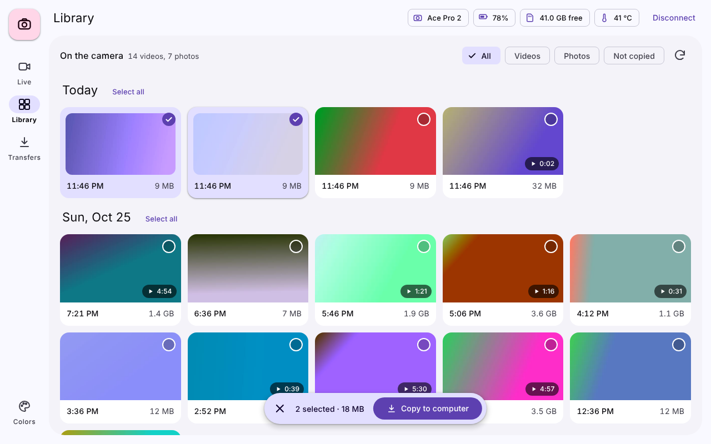
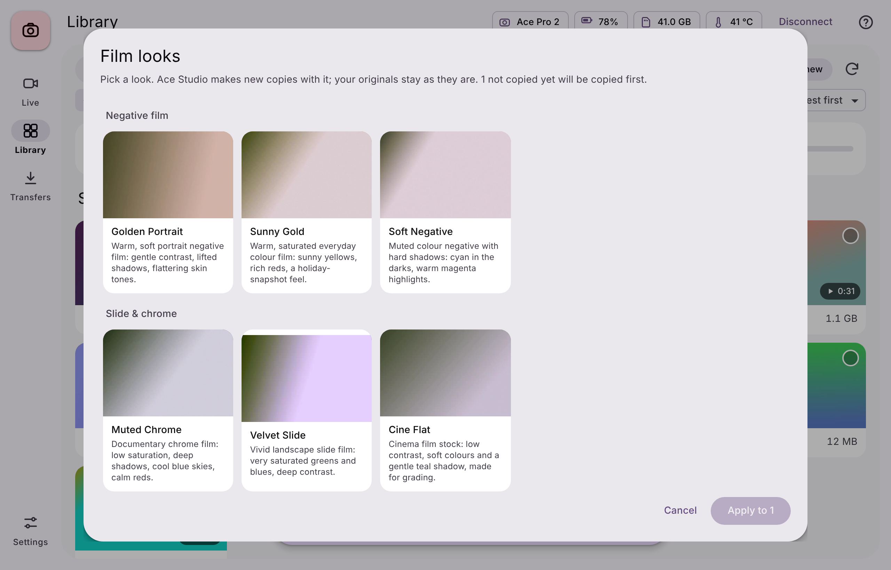
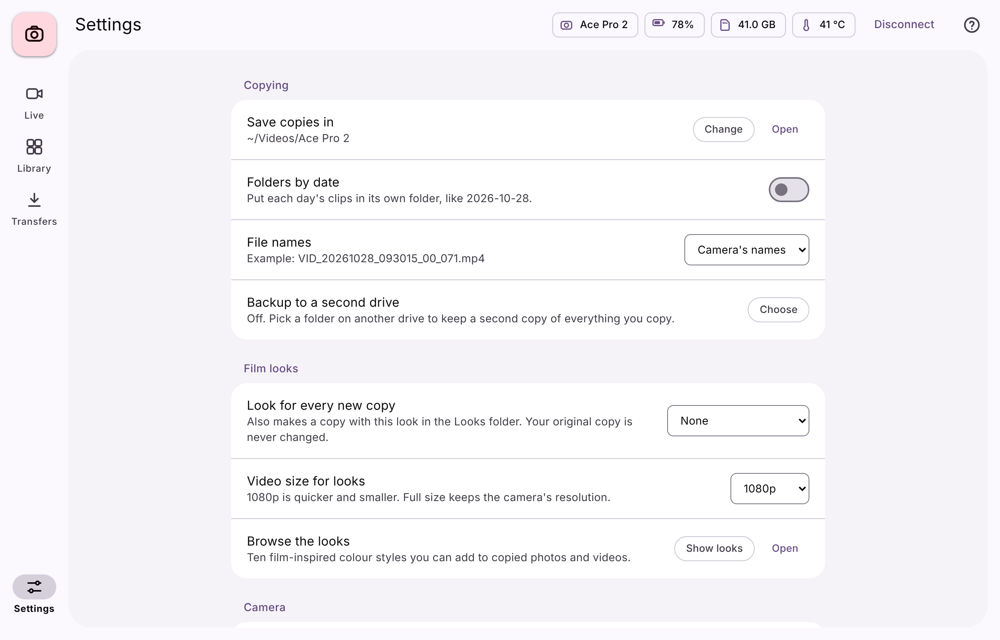

# Ace Studio

**An unofficial Linux desktop app for the Insta360 Ace Pro 2.** See the live view, record, and copy
your clips to your computer over the camera's own Wi-Fi or a USB cable, then give copies a film look.

Insta360 doesn't make software for Linux. Ace Studio fills part of that gap.

> **Unofficial.** Ace Studio is not affiliated with, endorsed by, or supported by Insta360.
> "Insta360" and "Ace Pro 2" are trademarks of their owner and are used here only to say which
> camera this app works with. Use at your own risk.



## Features

**Shooting**
- **Live view** with a framing grid and frame-rate / codec readout, plus a **delay test**
- **Record and take photos**, timed recording (30 seconds to 1 hour) and interval photos
- **Battery, free card space and temperature** at a glance

**Connecting**
- **Connects by itself** as soon as your computer joins the camera's Wi-Fi
- **Reconnects after drops** and picks up where it left off: live view comes back and copies resume
- **USB mode**: plug the camera in and browse and copy its card with no Wi-Fi at all
- **Camera clock**: set it from your computer's time zone when connecting, or leave it alone

**Library and copying**
- Everything on the card, grouped by day, with **search, sort and filters**
- **Copy all new** in one click; each copy is checked against the camera's file size
- **Folders by date**, readable **date-and-time file names**, and **backup to a second drive**
- **Favourites, notes, tags and trips** to find clips later
- **Duplicate check**: spots clips you already have elsewhere on your computer
- **Card overview**: how much is copied, how much isn't, and how much space is left
- **Photo and video details** (exposure, ISO, codec, frame rate and more)
- **Share copies**: small 1080p versions (2048 px for photos) for WhatsApp or Telegram
- A **reminder before disconnecting** if anything isn't copied yet
- **Delete from the camera** to free up the card, with a check that stops you deleting what isn't copied

**Film looks**
- 22 colour looks, each built as a proper 3D colour table (the kind pro editors use) and
  processed in 16-bit, with mid-tone film grain, red glow around lights on the night look,
  and soft vignettes. Each one shows what it's inspired by:

  | Look | Inspired by | | Look | Inspired by |
  |---|---|---|---|---|
  | Golden Portrait `GP` | Kodak Portra 400 | | Night Tungsten `NT` | CineStill 800T |
  | Sunny Gold `SG` | Kodak Gold 200 | | Positive `PO` | Ricoh GR Positive Film |
  | Bright Landscape `BL` | Kodak Ektar 100 | | Negative Snap `NS` | Ricoh GR Negative Film |
  | Pastel Portrait `PP` | Fujifilm Pro 400H | | Bleach Bypass `BB` | Ricoh GR Bleach Bypass |
  | Soft Negative `SN` | Fujifilm Classic Negative | | Rangefinder Natural `RN` | Leica standard colour |
  | Warm Memory `WM` | Fujifilm Nostalgic Neg | | Rangefinder Chrome `RC` | Leica Looks Chrome |
  | Muted Chrome `MC` | Fujifilm Classic Chrome | | Silver Mono `SM` | Leica Monochrom |
  | Velvet Slide `VS` | Fujifilm Velvia 50 | | Fine Mono `FM` | Fujifilm Acros |
  | Iconic Slide `IS` | Kodak Kodachrome 64 | | Classic Grain `CG` | Kodak Tri-X 400 |
  | Cine Flat `CF` | Fujifilm Eterna | | Hard Mono `HM` | Ricoh GR Hi-Contrast B&W |
  | Instant Photo `IP` | Polaroid 600 | | Purple Dream `PD` | LomoChrome Purple |

- Preview any look on your own shot, apply one or **all 22 at once**, or pick one for every new copy
- Looks are added to **new copies**, all in one `Looks` folder with a short code in the file name.
  Your originals are never changed.

**Comfort**
- **Settings** page, a short **welcome guide**, and **keyboard shortcuts** (press <kbd>?</kbd>)
- **Light, dark or system theme**, with Material 3 colours from one seed colour or your latest shot
- **English and Bahasa Melayu**
- Remembers the window size and the last tab you used
- Tells you when a new version is out

| Library | Film looks | Settings |
|---|---|---|
|  |  |  |

## Tested on

| | Status |
|---|---|
| Zorin OS 17 + Insta360 Ace Pro 2 | ✅ Tested |
| Ubuntu 22.04 / 24.04, Pop!_OS, Linux Mint, Debian 12 | Should work (same installer), not yet tested |
| Fedora 40+ | Should work, not yet tested. The installer adds RPM Fusion for full ffmpeg |
| Arch, EndeavourOS, Manjaro | Should work, not yet tested |
| openSUSE and others | ❌ Not yet |
| Other Insta360 cameras | Unknown. The camera library was built on the X3 and X4, so they may work |

If you try it on something not listed, please [open an issue](../../issues) and say how it went.

## Install

You need a Debian/Ubuntu-based distro, Fedora, or an Arch-based distro, with Python 3.10 or newer.
Run this while you're on your normal internet connection, **not** the camera's Wi-Fi:

```bash
git clone https://github.com/dhaneshshanmugam36-alt/ace-studio.git
cd ace-studio
./install.sh
```

Then open **Ace Studio** from your app menu. To try the interface without a camera:

```bash
ace-studio --demo
```

**Updating:** `cd ace-studio && git pull && ./install.sh`. Your settings, notes and copies are kept.

To remove it: `./uninstall.sh` (your copied clips are kept).

## Use

1. Turn on the camera's Wi-Fi (swipe down on the camera's screen).
2. Join the camera's Wi-Fi network from your computer. The password is in the camera's Wi-Fi settings.
3. Ace Studio connects by itself. (You can also press **Connect**.)

Or plug the camera in with a USB cable and choose **Open Library** to copy straight from the card.

Copies go to `~/Downloads/Ace Pro 2`, with pictures in `Pictures` and videos in `Videos`
(change both in Settings). Share copies go to the `Share` folder inside it, and film-look copies
to the `Looks` folder, with the look's code at the end of the name
(`IMG_1124 SN.jpg` = Soft Negative). `Look codes.txt` in that folder lists every code.

**Keyboard:** press <kbd>?</kbd> in the app for the full list. The main ones:
<kbd>Space</kbd> records or takes a photo, <kbd>L</kbd> toggles live view, <kbd>1</kbd> <kbd>2</kbd>
<kbd>3</kbd> switch tabs, <kbd>/</kbd> searches, <kbd>N</kbd> copies all new, <kbd>F</kbd> favourites
the selection, <kbd>Ctrl</kbd>+<kbd>A</kbd> selects everything and <kbd>Esc</kbd> clears it.

**Measuring live-view delay:** turn on live view, press **Delay test**, and point the camera at your
screen so the screen fills most of the picture. The window flashes white six times and Ace Studio
times how long each flash takes to appear in the live view.

**If the Wi-Fi keeps dropping:** turn off Wi-Fi power saving, and stop your computer from jumping
back to your home network while it's on the camera's.

### Options

```
ace-studio --camera 192.168.42.1   # camera address, if yours is different
ace-studio --save-dir ~/Footage    # where copies go, for this run only
ace-studio --browser               # open in your browser instead of the app window
ace-studio --debug                 # detailed log in the terminal (useful for bug reports)
```

## How it works

Ace Studio runs a small local web server and shows its interface in a native window.
It talks to the camera the same way Insta360's phone app does:

- **Control and status** over the camera's control port, using the open-source
  [`insta360`](https://pypi.org/project/insta360/) Python library
- **Files** over the camera's built-in web server, or straight from the card over USB
- **Film looks** are ffmpeg colour filters applied to a new copy on your computer
- **Live view** decoded with ffmpeg; the computer adds only around 10 ms of delay

## Limits

- This relies on an **unofficial**, community-documented protocol. A camera firmware update could
  break some features until the app is updated.
- **Timed recording and interval photos** are run by the computer, so keep Ace Studio open and
  connected while they run.
- **Not possible:** FlowState stabilisation, AI editing, reframing, and the camera's own menus.
  Those live inside Insta360's own apps.
- The film looks are Ace Studio's own hand-tuned colour styles. They're inspired by the films and
  camera modes named above, not copies of anyone's processing. Kodak, Fujifilm, Ricoh, Leica,
  CineStill, Polaroid and Lomography are trademarks of their owners; Ace Studio isn't affiliated
  with any of them.
- Ace Studio only deletes files from the camera when you ask it to, and always asks first.
  It never changes the camera's firmware.

## Roadmap

- **2.1:** camera settings (resolution, frame rate, colour profile), saved shooting recipes, a
  pre-shoot check, recording time left, overheating warning, a global record hotkey, marking
  moments while recording, and recording the live view
- **2.2:** play clips in the app, full-size viewing, hover preview, quick trim, timelapse maker,
  slideshow, contact sheet and stats
- A Flatpak or AppImage, and confirmed support for more Insta360 cameras (help from owners welcome)

Ideas and bug reports are welcome in [Issues](../../issues).

## Reporting a bug

Run `ace-studio --debug` in a terminal, reproduce the problem, and paste the terminal output into a
new issue along with your distro, camera model and camera firmware version.

## Credits

- [`insta360`](https://pypi.org/project/insta360/) Python library, which implements the camera's
  Wi-Fi protocol
- [insta360-wifi-api](https://github.com/RigacciOrg/insta360-wifi-api) by Niccolo Rigacci, the original
  reverse-engineering work this builds on
- [ffmpeg](https://ffmpeg.org/), [Flask](https://flask.palletsprojects.com/) and
  [pywebview](https://pywebview.flowrl.com/)

## Licence

[GPL-3.0-or-later](LICENSE), the same licence as the camera library it uses.
This software comes with no warranty.
