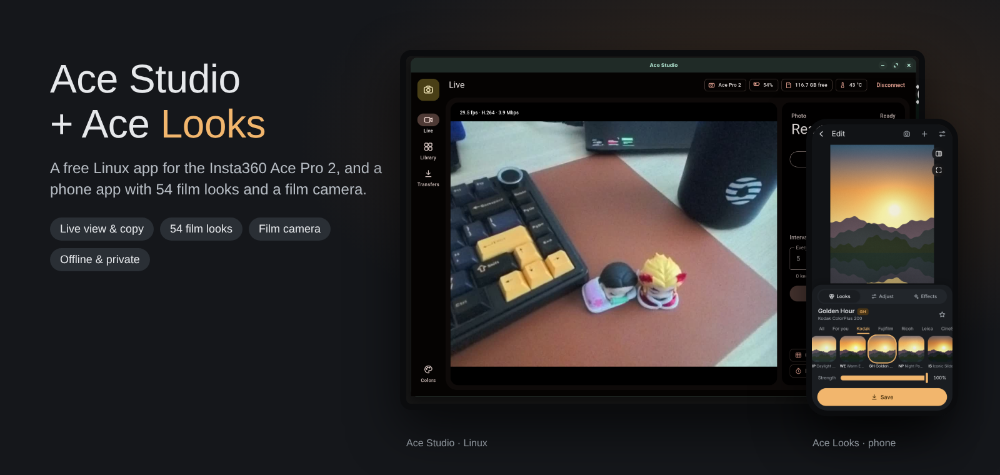
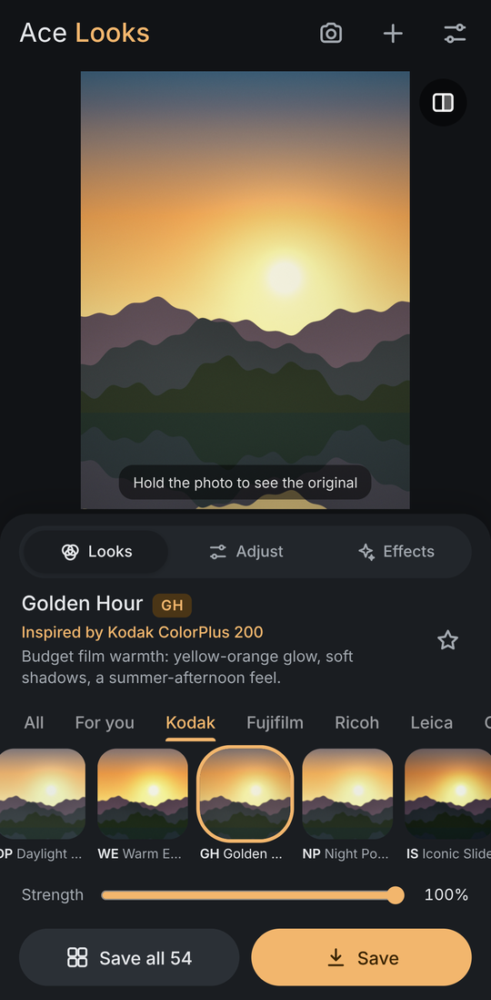
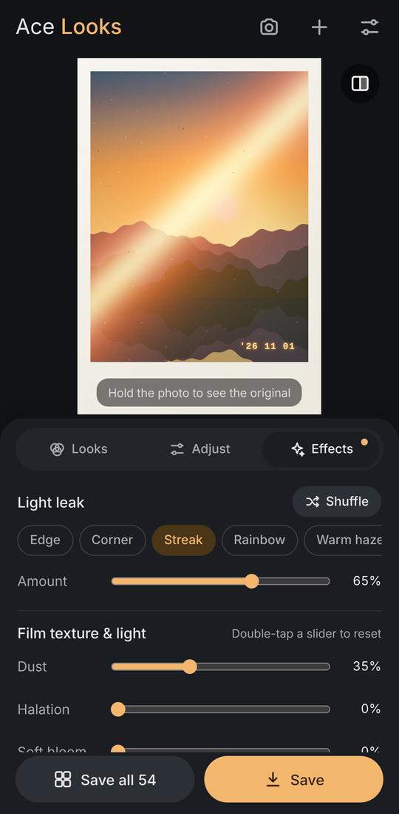
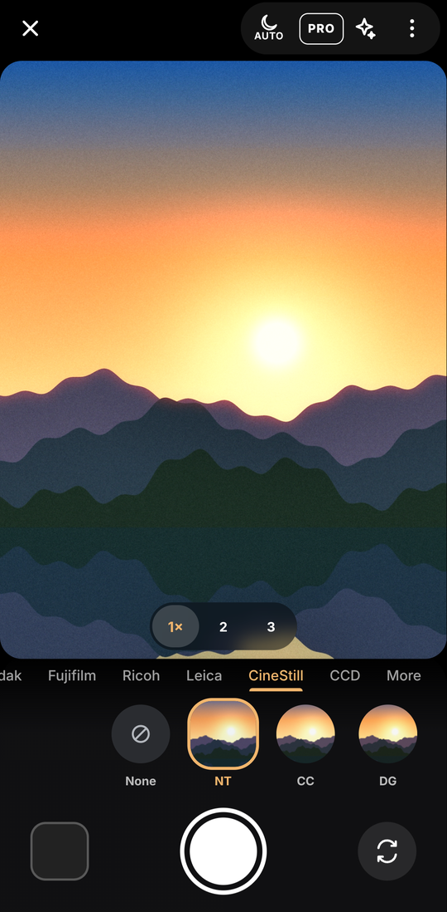
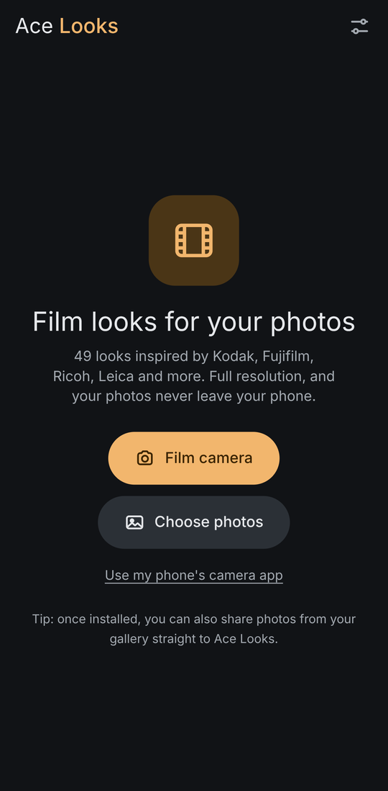
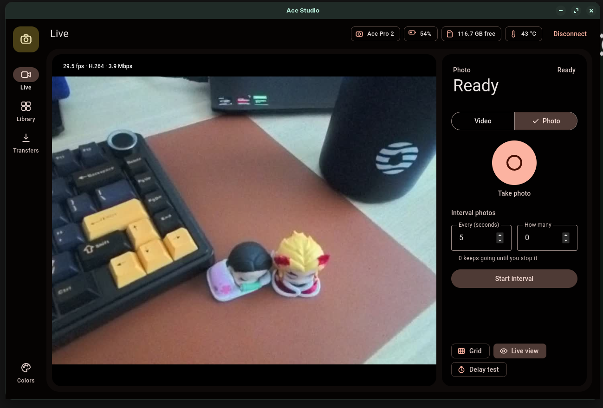
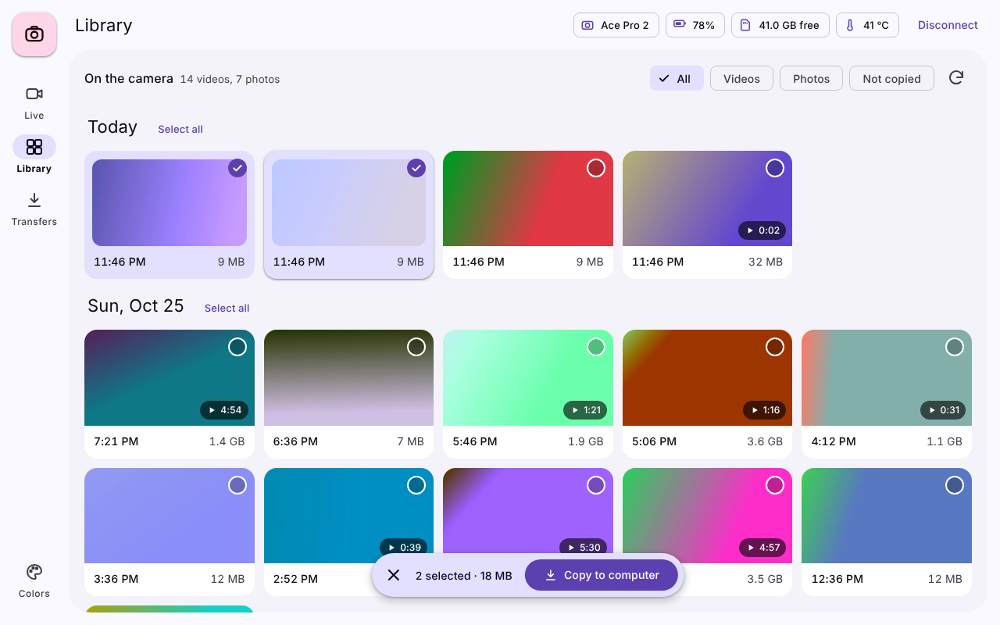
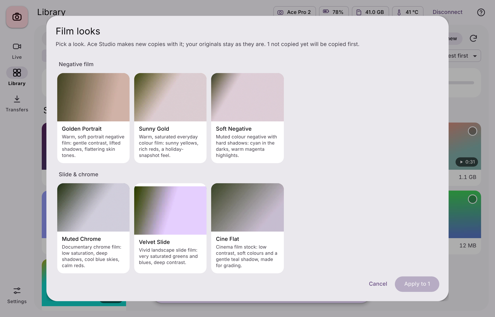
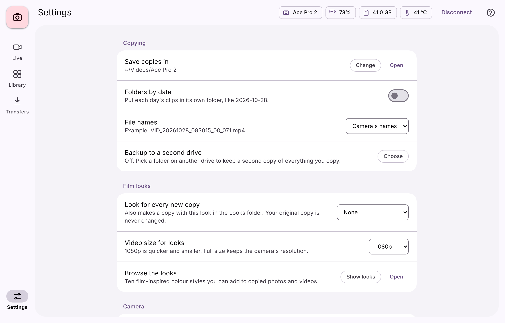

<p align="center"></p>

<h1 align="center">Ace Studio + Ace Looks</h1>

<p align="center">Two free apps in one project. Pick the one for your device.</p>

<table>
<tr>
<td width="50%" valign="top">

### 📱 Ace Looks
**For your phone** (Android + Chrome)

54 film looks, effects and a film camera for your photos.
Works with **any photo**. No Insta360 camera needed.

<a href="https://dhaneshshanmugam36-alt.github.io/ace-studio/phone/"></a>

1. Open the link above **on your phone** in Chrome
2. Tap **⋮** → **Install app**
3. Done. No app store, no account, no download

[More about Ace Looks ↓](#-ace-looks-phone-app)

</td>
<td width="50%" valign="top">

### 💻 Ace Studio
**For your Linux computer**

Live view, recording and copying files for the
**Insta360 Ace Pro 2**, plus the same film looks.

<a href="#install"></a>

```bash
git clone https://github.com/dhaneshshanmugam36-alt/ace-studio.git
cd ace-studio && ./install.sh
```

[More about Ace Studio ↓](#-ace-studio-linux-desktop-app)

</td>
</tr>
</table>

<p align="center">
  <a href="https://github.com/dhaneshshanmugam36-alt/ace-studio/releases/latest"></a>
  <a href="LICENSE"></a>
  
</p>

### Quick links

| I want to… | Go here |
|---|---|
| Use the **phone app** | **[dhaneshshanmugam36-alt.github.io/ace-studio/phone](https://dhaneshshanmugam36-alt.github.io/ace-studio/phone/)** (open it on your phone) |
| Install the **Linux app** | [Install steps](#install) |
| See what changed | [Releases](https://github.com/dhaneshshanmugam36-alt/ace-studio/releases) · [Changelog](CHANGELOG.md) |
| Report a problem or ask for a feature | [Issues](https://github.com/dhaneshshanmugam36-alt/ace-studio/issues/new/choose) |

> **Good to know:** Ace Looks is **not** on the Play Store or App Store. The link above is the only official way to get it.
> It's made for Android phones with Chrome; on iPhone or a computer it opens, but the camera may not work fully.
> Ace Studio is for Linux only. Both are free and open source: no sign-up, no ads, no payment.

---

## 📱 Ace Looks (phone app)

<p align="center">
  
  
  
  
</p>

### Get it (1 minute)

1. On your Android phone, open **[dhaneshshanmugam36-alt.github.io/ace-studio/phone/](https://dhaneshshanmugam36-alt.github.io/ace-studio/phone/)** in **Chrome**.
2. Tap **⋮** (top right) → **Install app** (or *Add to Home screen*).
3. Open **Ace Looks** from your home screen. It works offline from then on.

Updates arrive by themselves the next time you open it with internet.

### What it does

- **Film camera:** see the film look live while you shoot. Swipe to change looks, tap to focus, pinch to zoom (up to 3×).
  Daylight shots use the camera's full-resolution stills. In the dark, **Night mode** merges 8 frames to cut
  noise, and **Smart HDR** brings out shadows. After each shot you see it first, then **Save**, **Edit** or
  **Delete**. Saved shots keep the look *and* a clean original.
- **Your photos:** choose photos from your gallery, use your phone's own camera app, or share photos to Ace Looks
  from the gallery.
- **Tabs by maker:** Kodak, Fujifilm, Ricoh, Leica, CineStill, CCD digicams and more, plus For you and Favourites.
- **For you:** the 4 looks that suit each photo (people, landscape, sky, night, indoor) show first.
- **Simple controls:** three tabs, **Looks**, **Adjust** (light, contrast, warmth) and **Effects**. Hold the photo
  to compare with the original. **Auto fix** and natural skin tones are on by default.
- **Effects:** light leaks (6 styles + shuffle), dust & scratches, halation, soft bloom, vignette, grain, an orange
  date stamp, and frames (Polaroid, 35 mm film strip, white or black border). Live in the camera too.
- **Preview before saving:** see exactly what will be saved, at its real size, before anything is downloaded.
- **Recent:** your saved photos stay on the home screen, so you can reopen and edit them again.
- **Save** one look, your favourites, the suggested looks, or **all 54**, at full resolution, with the photo's
  date, camera and location kept. Files are named like `IMG_1124 SN.jpg` (`SN` = Soft Negative).
- **Private:** everything runs on your phone. Photos are never uploaded anywhere.

> Works best in Chrome on Android. Other browsers may not support every camera feature.
> For the hardest light (very dark scenes), your phone's own camera app still wins; use **Use my phone's camera app**
> on the home screen and the photo comes straight into Ace Looks.

---

## 💻 Ace Studio (Linux desktop app)

<p align="center"></p>

Insta360 doesn't make software for Linux. Ace Studio fills part of that gap.

### Install

You need a Debian/Ubuntu-based distro (Zorin, Ubuntu, Pop!_OS, Mint, Debian), Fedora, or an Arch-based distro,
with Python 3.10 or newer. Run this on your normal internet, **not** the camera's Wi-Fi:

```bash
git clone https://github.com/dhaneshshanmugam36-alt/ace-studio.git
cd ace-studio
./install.sh
```

Then open **Ace Studio** from your app menu. Try it without a camera: `ace-studio --demo`

- **Update:** `cd ace-studio && git pull && ./install.sh` (settings, notes and copies are kept)
- **Remove:** `./uninstall.sh` (your copied clips are kept)

### Use

1. Turn on the camera's Wi-Fi (swipe down on the camera's screen).
2. Join the camera's Wi-Fi network from your computer. The password is in the camera's Wi-Fi settings.
3. Ace Studio connects by itself.

Or plug the camera in with a USB cable and choose **Open Library**.

Copies go to `~/Downloads/Ace Pro 2`, with `Pictures` and `Videos` folders (change it in Settings).
Film-look copies go to the `Looks` folder with the look's code in the name.

### Features

**Shooting:** live view with grid and delay test · record and take photos · timed recording and interval photos ·
battery, card space and temperature at a glance

**Connecting:** connects by itself · reconnects after Wi-Fi drops and resumes copies · USB mode · camera clock from
your computer

**Library and copying:** search, sort, filters · **Copy all new** with size checks · folders by date and readable
file names · backup to a second drive · favourites, notes, tags and trips · duplicate check · card overview ·
photo and video details · small share copies for WhatsApp · reminder before disconnecting · delete from the
camera with a safety check

**Film looks:** all 54 looks, For you suggestions, Auto fix, natural skin, favourites, apply one or all 54

**Comfort:** settings page, welcome guide, keyboard shortcuts (<kbd>?</kbd>), light/dark theme with Material 3
colours, English and Bahasa Melayu, update notices

| Library | Film looks | Settings |
|---|---|---|
|  |  |  |

<details>
<summary><b>More: keyboard shortcuts, options, tested distros, how it works</b></summary>

### Keyboard

<kbd>Space</kbd> records or takes a photo · <kbd>L</kbd> live view · <kbd>1</kbd> <kbd>2</kbd> <kbd>3</kbd> switch
tabs · <kbd>/</kbd> search · <kbd>N</kbd> copy all new · <kbd>F</kbd> favourite · <kbd>Delete</kbd> delete from
camera · <kbd>Ctrl</kbd>+<kbd>A</kbd> select all · <kbd>Esc</kbd> clear · <kbd>?</kbd> all shortcuts

### Options

```
ace-studio --demo                  # try it with a pretend camera
ace-studio --camera 192.168.42.1   # camera address, if yours is different
ace-studio --save-dir ~/Footage    # where copies go, for this run only
ace-studio --browser               # open in your browser instead of the app window
ace-studio --debug                 # detailed log (useful for bug reports)
```

### Tested on

| | Status |
|---|---|
| Zorin OS 17 + Insta360 Ace Pro 2 | ✅ Tested |
| Ubuntu 22.04 / 24.04, Pop!_OS, Linux Mint, Debian 12 | Should work (same installer), not yet tested |
| Fedora 40+ | Should work, not yet tested. The installer adds RPM Fusion for full ffmpeg |
| Arch, EndeavourOS, Manjaro | Should work, not yet tested |
| openSUSE and others | ❌ Not yet |
| Other Insta360 cameras | Unknown. The camera library was built on the X3 and X4, so they may work |

If you try it on something not listed, please [open an issue](../../issues) and say how it went.

### How it works

Ace Studio runs a small local web server and shows its interface in a native window.
It talks to the camera the same way Insta360's phone app does:

- **Control and status** over the camera's control port, using the open-source
  [`insta360`](https://pypi.org/project/insta360/) Python library
- **Files** over the camera's built-in web server, or straight from the card over USB
- **Film looks** are ffmpeg colour filters applied to a new copy on your computer
- **Live view** decoded with ffmpeg; the computer adds only around 10 ms of delay

**If the Wi-Fi keeps dropping:** turn off Wi-Fi power saving, and stop your computer from jumping back to your home
network while it's on the camera's.

</details>

---

## 🎞️ The 54 film looks

Each look is Ace Studio's own colour style, hand-tuned to resemble a classic film or camera mode. Every look is a
proper 3D colour table processed in high precision, with film-style highlight roll-off, mid-tone grain, soft
vignettes, and a red glow around lights on the cinema looks. The two letters are added to saved file names.

| Look | Inspired by | | Look | Inspired by |
|---|---|---|---|---|
| Golden Portrait `GP` | Kodak Portra 400 | | Cinema Bleach `EB` | Fujifilm Eterna Bleach Bypass |
| Sunny Gold `SG` | Kodak Gold 200 | | Night Cinema `NC` | Kodak Vision3 500T |
| Bright Landscape `BL` | Kodak Ektar 100 | | Daylight Glow `DG` | CineStill 400D |
| Pastel Portrait `PP` | Fujifilm Pro 400H | | Positive `PO` | Ricoh GR Positive Film |
| Soft Negative `SN` | Fujifilm Classic Negative | | Negative Snap `NS` | Ricoh GR Negative Film |
| Warm Memory `WM` | Fujifilm Nostalgic Neg | | Bleach Bypass `BB` | Ricoh GR Bleach Bypass |
| Daylight Portrait `DP` | Kodak Portra 160 | | Retro Snap `RT` | Ricoh GR Retro |
| Everyday Green `EG` | Fujifilm Superia 400 | | Cross Process `XP` | Ricoh GR Cross Processing |
| Warm Everyday `WE` | Kodak Ultramax 400 | | Rangefinder Natural `RN` | Leica standard colour |
| Golden Hour `GH` | Kodak ColorPlus 200 | | Rangefinder Chrome `RC` | Leica Looks Chrome |
| Summer Red `SR` | Agfa Vista 200 | | Rangefinder Classic `LC` | Leica Looks Classic |
| Night Portrait `NP` | Kodak Portra 800 | | Rangefinder Modern `LM` | Leica Looks Contemporary |
| Cool Everyday `CE` | Fujicolor C200 | | Silver Mono `SM` | Leica Monochrom |
| Real Colour `RA` | Fujifilm Reala Ace | | Fine Mono `FM` | Fujifilm Acros |
| Muted Chrome `MC` | Fujifilm Classic Chrome | | Classic Grain `CG` | Kodak Tri-X 400 |
| Velvet Slide `VS` | Fujifilm Velvia 50 | | Hard Mono `HM` | Ricoh GR Hi-Contrast B&W |
| Iconic Slide `IS` | Kodak Kodachrome 64 | | Street Mono `ST` | Ilford HP5 Plus |
| Vivid Slide `VI` | Fujifilm Velvia 100 | | Selenium Mono `SE` | Leica Looks Selenium |
| Clean Slide `CS` | Kodak Ektachrome E100 | | Smooth Mono `TM` | Kodak T-Max 100 |
| True Slide `TS` | Fujifilm Provia 100F | | Night Mono `DM` | Ilford Delta 3200 |
| Soft Slide `AS` | Fujifilm Astia 100F | | Instant Photo `IP` | Polaroid 600 |
| Cine Flat `CF` | Fujifilm Eterna | | Purple Dream `PD` | LomoChrome Purple |
| Night Tungsten `NT` | CineStill 800T | | Ember `EM` | Harman Phoenix 200 |
| Clean Cinema `CC` | CineStill 50D | | Metro `MT` | Lomography Metropolis |
| Cine Daylight `CD` | Kodak Vision3 250D | | Cool Digicam `CB` | Canon IXUS CCD (2000s) |
| Pocket Pop `CP` | Nikon Coolpix CCD (2000s) | | Soft Pixel `FP` | Fujifilm FinePix CCD (2000s) |
| Crisp Contrast `CY` | Sony Cyber-shot CCD (2000s) | | Party Flash `DF` | 2000s compact camera with flash |

<sub>Kodak, Fujifilm, Ricoh, Leica, CineStill, Polaroid, Agfa, Ilford, Harman, Lomography, Canon, Nikon and Sony are trademarks of their owners.
Ace Studio isn't affiliated with any of them; the names only say what each look is inspired by.</sub>

---

## FAQ

**Is it really free? Any ads or accounts?**
Yes, free. No ads, no accounts, no tracking.

**Do my photos get uploaded?**
No. Ace Looks runs completely on your phone, and Ace Studio runs on your computer.

**Does Ace Looks work on iPhone?**
It's built and tested for Chrome on Android. Safari on iPhone may open it, but the camera and saving may not work fully.

**Will Ace Studio work with my other Insta360 camera?**
Maybe. It's tested on the Ace Pro 2. The camera library it uses was built on the X3 and X4. Please
[open an issue](https://github.com/dhaneshshanmugam36-alt/ace-studio/issues) and say how it went.

**Does it work on Windows or macOS?**
Ace Studio is Linux only for now. Ace Looks works in any modern browser.

**Will it delete anything from my camera?**
Only when you choose Delete, and it always asks first. It never changes the camera's firmware.

---

## Limits

- This relies on an **unofficial**, community-documented protocol. A camera firmware update could
  break some features until the app is updated.
- **Timed recording and interval photos** are run by the computer, so keep Ace Studio open and
  connected while they run.
- **Not possible:** FlowState stabilisation, AI editing, reframing, and the camera's own menus.
  Those live inside Insta360's own apps.
- The film looks are Ace Studio's own hand-tuned colour styles. They're inspired by the films and
  camera modes named above, not copies of anyone's processing. Kodak, Fujifilm, Ricoh, Leica,
  CineStill, Polaroid, Lomography, Canon, Nikon and Sony are trademarks of their owners; Ace Studio isn't affiliated
  with any of them.
- Ace Studio only deletes files from the camera when you ask it to, and always asks first.
  It never changes the camera's firmware.

## Roadmap

- **2.1:** camera settings (resolution, frame rate, colour profile), saved shooting recipes, a
  pre-shoot check, recording time left, overheating warning, a global record hotkey, marking
  moments while recording, and recording the live view
- **2.2:** play clips in the app, full-size viewing, hover preview, quick trim, timelapse maker,
  slideshow, contact sheet and stats
- A Flatpak or AppImage, and confirmed support for more Insta360 cameras (help from owners welcome)

Ideas and bug reports are welcome in [Issues](../../issues).

## Reporting a bug

[Open an issue](https://github.com/dhaneshshanmugam36-alt/ace-studio/issues/new/choose). For Ace Studio, run `ace-studio --debug`, repeat the problem, and paste the
terminal output. For Ace Looks, say your phone model and Chrome version.

## Credits

- [`insta360`](https://pypi.org/project/insta360/) Python library, which implements the camera's
  Wi-Fi protocol
- [insta360-wifi-api](https://github.com/RigacciOrg/insta360-wifi-api) by Niccolo Rigacci, the original
  reverse-engineering work this builds on
- [ffmpeg](https://ffmpeg.org/), [Flask](https://flask.palletsprojects.com/) and
  [pywebview](https://pywebview.flowrl.com/)

## Licence

[GPL-3.0-or-later](LICENSE), the same licence as the camera library it uses.
This software comes with no warranty.

> **Unofficial.** Not affiliated with, endorsed by, or supported by Insta360. "Insta360" and "Ace Pro 2" are
> trademarks of their owner and are used only to say which camera this works with.
