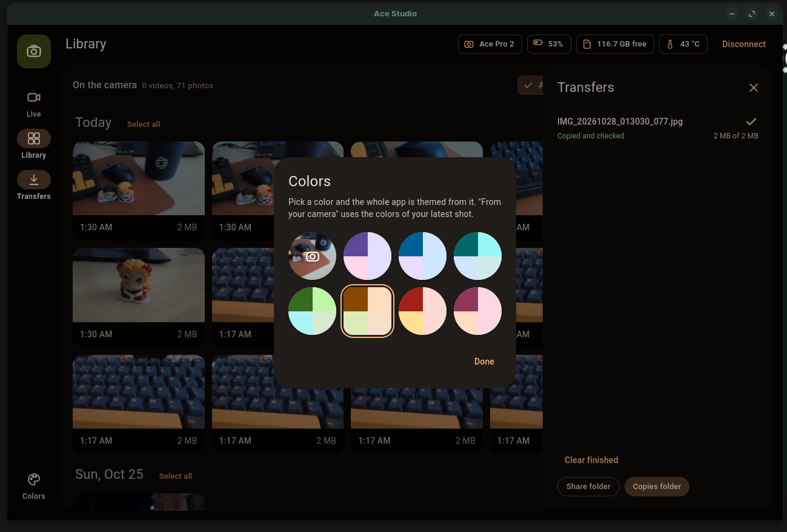
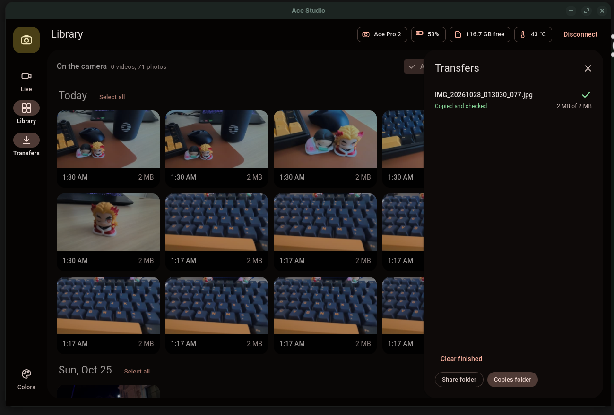

# Ace Studio

**An unofficial Linux desktop app for the Insta360 Ace Pro 2.** See the live view, record, and copy
your clips to your computer over the camera's own Wi-Fi.

Insta360 doesn't make software for Linux. Ace Studio fills part of that gap.

> **Unofficial.** Ace Studio is not affiliated with, endorsed by, or supported by Insta360.
> "Insta360" and "Ace Pro 2" are trademarks of their owner and are used here only to say which
> camera this app works with. Use at your own risk.


## Features

- **Live view** from the camera, with a framing grid and frame-rate / codec readout
- **Delay test** that measures how far the live view lags behind real life
- **Record and take photos**, and switch between Video and Photo mode
- **Timed recording**: stops by itself after 30 seconds to 1 hour
- **Interval photos**: one photo every few seconds, for a set number or until you stop
- **Library** of everything on the memory card, grouped by day, with thumbnails
- **Copy to computer** in the background with progress and cancel. A clip only shows "Copied" when
  the file on your computer is the same size as the one on the camera.
- **Share copies**: small 1080p versions of copied clips (2048 px for photos), ready for WhatsApp or Telegram
- **Battery, free card space and temperature** at a glance
- **Material 3 design** with colors generated from one seed color, or taken from your latest shot.
  Follows your system's light or dark mode.

| Library | Colors | Copying to your computer |
|---|---|---|
|  |  |  |


## Tested on

| | Status |
|---|---|
| Zorin OS 17 + Insta360 Ace Pro 2 | ✅ Tested |
| Ubuntu 22.04 / 24.04, Pop!_OS, Linux Mint, Debian 12 | Should work (same installer), not yet tested |
| Fedora, Arch, openSUSE | ❌ Not yet. Planned for version 2 |
| Other Insta360 cameras | Unknown. The camera library was built on the X3 and X4, so they may work |

If you try it on something not listed, please [open an issue](../../issues) and say how it went.

## Install

You need a Debian/Ubuntu-based distro with Python 3.10 to 3.12. Run this while you're on your normal
internet connection, **not** the camera's Wi-Fi:

```bash
git clone https://github.com/dhaneshshanmugam36-alt/ace-studio.git
cd ace-studio
./install.sh
```

Then open **Ace Studio** from your app menu. To try the interface without a camera:

```bash
ace-studio --demo
```

To remove it: `./uninstall.sh` (your copied clips are kept).

## Use

1. Turn on the camera's Wi-Fi (swipe down on the camera's screen).
2. Join the camera's Wi-Fi network from your computer. The password is in the camera's Wi-Fi settings.
3. Open Ace Studio and press **Connect**.

Copies go to `~/Videos/Ace Pro 2`, share copies to `~/Videos/Ace Pro 2/Share`.

**Keyboard:** <kbd>Space</kbd> starts and stops recording on the Live tab. In the Library,
<kbd>Ctrl</kbd>+<kbd>A</kbd> selects everything, <kbd>Shift</kbd>+click selects a range,
and <kbd>Esc</kbd> clears the selection.

**Measuring live-view delay:** turn on live view, press **Delay test**, and point the camera at your
screen so the screen fills most of the picture. The window flashes white six times and Ace Studio
times how long each flash takes to appear in the live view.

### Options

```
ace-studio --camera 192.168.42.1   # camera address, if yours is different
ace-studio --save-dir ~/Footage    # where copies go
ace-studio --browser               # open in your browser instead of the app window
ace-studio --debug                 # detailed log in the terminal (useful for bug reports)
```

## How it works

Ace Studio runs a small local web server and shows its interface in a native window.
It talks to the camera the same way Insta360's phone app does:

- **Control and status** over the camera's control port, using the open-source
  [`insta360`](https://pypi.org/project/insta360/) Python library
- **Files** over the camera's built-in web server
- **Live view** decoded with ffmpeg; the computer adds only around 10 ms of delay

## Limits

- This relies on an **unofficial**, community-documented protocol. A camera firmware update could
  break some features until the app is updated.
- **Timed recording and interval photos** are run by the computer, so keep Ace Studio open and
  connected while they run.
- **Not possible:** FlowState stabilisation, AI editing, reframing, and the camera's own menus.
  Those live inside Insta360's own apps.
- Ace Studio never deletes files from the camera and never changes its firmware.

## Roadmap

- **Version 2:** Fedora and Arch support, newer Python versions, and a Flatpak or AppImage so it
  installs the same way on any distro
- Confirmed support for more Insta360 cameras (help from owners welcome)
- Playing copied clips inside the app

Ideas and bug reports are welcome in [Issues](../../issues).

## Reporting a bug

Run `ace-studio --debug` in a terminal, reproduce the problem, and paste the terminal output into a
new issue along with your distro, camera model and camera firmware version.

## Credits

- [`insta360`](https://pypi.org/project/insta360/) Python library, which implements the camera's
  Wi-Fi protocol
- [insta360-wifi-api](https://github.com/RigacciOrg/insta360-wifi-api) by Niccolo Rigacci, the original
  reverse-engineering work this builds on
- [ffmpeg](https://ffmpeg.org/), [Flask](https://flask.palletsprojects.com/) and
  [pywebview](https://pywebview.flowrl.com/)

## Licence

[GPL-3.0-or-later](LICENSE), the same licence as the camera library it uses.
This software comes with no warranty.
